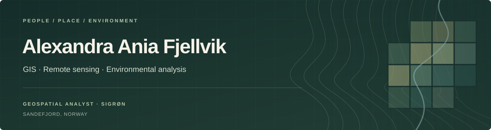

### Hi, I'm Alexandra 👋

Geospatial analyst based in **Sandefjord, Norway**, working across **GIS**, **satellite remote sensing** and **environmental analysis**. My background combines an MSc in GIS & Remote Sensing with human geography and experience in marine, coastal and land-based projects. Through **Sigrøn**, I develop independent projects exploring how geographic data can help us understand environmental change.

- 🛰️ **Focus:** environmental mapping, coastal and marine analysis, vegetation monitoring and change detection
- 🌿 **Current explorations:** Goksjø water quality, light pollution, kelp mapping and drone crop analysis
- 🎓 **Research:** Scandinavian boreal forests, forest composition and moisture patterns
- 🌍 **Portfolio:** [Projects, maps and research](https://alexandrafjellvik.github.io/portfolio.html)

### 🗺️ Selected projects

| Project | What it explores | Methods & context |
|---|---|---|
| [**SALT Trail 2.0**](https://alexandrafjellvik.github.io/portfolio.html#salt-trail) | Using satellite observations and environmental context to investigate the impacts of nature-based tourism in Lofoten | Geospatial analysis · remote sensing · technical contribution at SALT |
| [**Goksjø water quality**](https://alexandrafjellvik.github.io/portfolio.html#goksjo) | Exploring water quality and cyanobacteria using satellite data, maps and local observations | Environmental monitoring · ongoing exploration |
| [**Darker Skies**](https://alexandrafjellvik.github.io/portfolio.html#darker-skies) | Mapping light pollution and exploring natural darkness, protected areas and human disturbance | Spatial analysis · project in development |
| [**Boreal forest research**](https://alexandrafjellvik.github.io/thesis.html) | Studying forest composition and moisture patterns in Trysil | Multitemporal remote sensing · NDMI · MSc research |
| [**Drone crop analysis**](https://alexandrafjellvik.github.io/portfolio.html#drones) | Exploring how drone imagery can support crop health assessment and reveal variation across agricultural fields | Drone imagery · vegetation analysis · exploratory work |
| [**Kelp forest monitoring**](https://alexandrafjellvik.github.io/portfolio.html#kelp) | Developing a workflow to detect kelp forests within selected areas of Norwegian fjords | Google Earth Engine · SVM classification · in development |

### 🛠️ Toolbox

**Methods:** SVM and Random Forest classification · multisensor analysis · cartography · LiDAR and photogrammetry exploration

### 📫 Connect

I'm interested in projects and opportunities that connect geospatial analysis with environmental questions and practical decisions.

